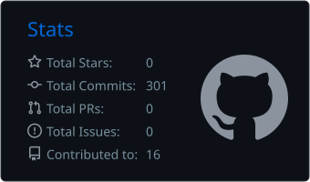
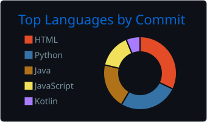

 

 

## ✨ About Me

I'm an **Electronics & Telecommunication Engineering** graduate passionate about software engineering, emerging technologies, and building practical solutions.

I enjoy working across many areas of development, from full-stack applications and backend architecture to local AI, Linux, and system-level programming.

- 💻 Developing full-stack applications and desktop software
- 🤖 Exploring local LLMs, AI agents, and RAG architectures
- 🐧 Interested in Linux, open-source software, and desktop technologies
- ⚙️ Exploring C++, robotics, embedded systems, and automation
- 🌱 Continuously learning and building new things

 

## 🛠️ Technical Skills

 
<table align="center">
  <tr>
    <td width="200" align="right"><b>Languages</b></td>
    <td></td>
  </tr>
  <tr>
    <td width="200" align="right"><b>Frontend & Backend</b></td>
    <td></td>
  </tr>
  <tr>
    <td width="200" align="right"><b>Databases & Cloud</b></td>
    <td></td>
  </tr>
  <tr>
    <td width="200" align="right"><b>AI, Tools & Platforms</b></td>
    <td></td>
  </tr>
</table>

 

## 🚀 Featured Projects

<table>
<tr>
<td width="33%" valign="top">

### 🤖 Vector
A local-first AI desktop assistant focused on conversational AI, local LLM integration, and knowledge retrieval.

 

`Cactus Needle` `Ollama` `RAG` `Desktop`

</td>
<td width="33%" valign="top">

### 🎵 MusifyBeats
A full-stack music streaming application with microservices architecture, authentication, and playlist management.

 

`React` `Spring Boot` `ASP.NET Core` `MSSQL`

</td>
<td width="33%" valign="top">

### 📱 DIY Phone Link
An experimental Android and desktop integration project exploring connected-device functionality.

 

`Android` `Kotlin` `Desktop`

</td>
</tr>
</table>

 

## 🔭 Currently Exploring

| Area | Interests |
|:---|:---|
| 🧠 **Artificial Intelligence** | Local LLMs · AI Agents · RAG · Model Optimization |
| 🏗️ **Software Engineering** | System Design · Microservices · Desktop Applications |
| ⚡ **Systems Development** | C++ · Linux · System Programming |
| 🤖 **Hardware & Robotics** | Embedded Systems · IoT · Robotics |

 

## 📊 GitHub Statistics

  

  

 

**Thanks for visiting my profile!**

*Always curious. Always building. Always learning.*

